# はじめてのコーヒー教科書

## 基礎から産地理解、レシピ設計まで

この教科書の目的は、用語を暗記することではありません。コーヒーがどのような植物で、どのような環境と工程を経て一杯になり、味の違いがどこから生まれるのかを順番に理解することです。読み終えたときには、商品表示を根拠に豆を選び、味を観察し、ハンドドリップのレシピを自分で調整できる状態を目指します。

本文で示す産地の風味は、同程度の焙煎度と抽出条件で比較したときに見られやすい傾向です。国名、地域名、品種名、精製名のどれか一つで、実際の味が決まるわけではありません。

## この教科書の使い方

最初は第1部を順番に読み、第7章の基準レシピで実際に一杯淹れてください。第2部は国名の暗記ではなく、同じ比較軸で二つの産地を比べながら読みます。第3部では、手元の抽出記録を使って一項目ずつ調整します。

各章を読んだ後は、別冊の[理解確認ワークブック](coffee-textbook-workbook.md)に取り組みます。答えを見る前に、自分の言葉で説明することが重要です。分からない用語は巻末の用語集で確認し、それでも曖昧なら本文へ戻ります。

この教科書にある「傾向」は、個別の豆に必ず当てはまる規則ではありません。また、抽出の調整例は唯一の正解ではなく、原因を切り分けるための比較方法です。

---

# 第1部　コーヒーを理解する基礎

## 第1章　コーヒーは果実の種である

**到達目標**：果実、生豆、焙煎豆、種、品種、精製を区別できる。

コーヒーノキは白い花を咲かせ、その後に赤や黄色へ熟す果実を実らせます。この果実がコーヒーチェリーです。果実の内部には通常二つの種が向かい合って入っています。果皮、果肉、粘液質などを取り除き、乾燥して保存できる状態にした未焙煎の種が生豆です。生豆を加熱すると、褐色の焙煎豆になります。

ここで「種」と「品種」を分けます。アラビカ、カネフォラ、リベリカは植物分類上の種です。一般にロブスタと呼ばれるものは、主にカネフォラ種の栽培群を指します。ティピカ、ブルボン、カトゥーラ、ゲシャなどは、アラビカ種の中にある品種または栽培系統です。品種によって樹の大きさ、収量、病害への強さ、適する環境、品質の可能性が異なります。

ただし、品種名は完成した味の名前ではありません。同じ品種でも、土地、気候、熟度、精製、焙煎、抽出が異なれば味は変わります。袋に「アラビカ／カトゥーラ／ウォッシュド」とあれば、順に「種／品種／精製」です。植物の情報と収穫後の工程を混同しないことが、表示を読む第一歩です。

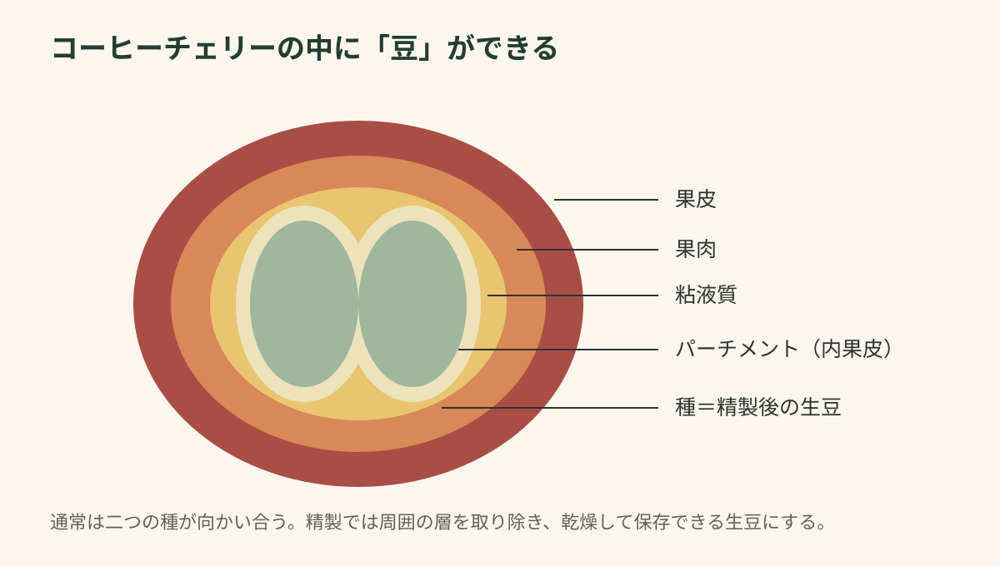

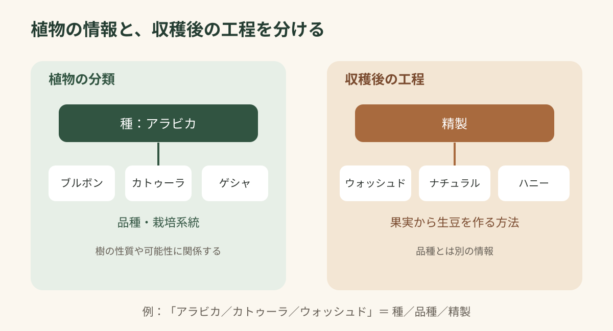

### 混同しやすい点

- 生豆は未熟な豆ではなく、精製・乾燥後で焙煎前の種である。
- アラビカとカネフォラは種、ティピカやブルボンは品種である。
- ピーベリーは独立した品種ではなく、通常は二つできる種のうち一つだけが発達し、丸みを帯びた形になったものを指す。

### 理解確認

1. 生豆と焙煎豆は、植物の異なる部位ですか。
2. 「ブルボン・ナチュラル」という表示から、植物情報と工程情報を分けてください。

## 第2章　味を「好き嫌い」と「観察」に分ける

**到達目標**：味、香り、質感、後味を分け、自分の言葉で記録できる。

「おいしい」「苦手」は大切な評価ですが、それだけでは次の豆選びに使える情報が不足します。評価とは別に、実際に感じたものを観察します。舌で感じる基本味には酸味、甘味、苦味などがあります。鼻で感じる香り、口に含んだときに鼻へ抜ける香り、舌触りとしての質感、飲み込んだ後に残る後味も、一杯の印象を構成します。

記録するときは、まず種類、その次に強さと質を言葉にします。「酸っぱい」だけでなく「柑橘を思わせる、明るい酸」「リンゴを思わせる、丸い酸」と書きます。「苦い」も「カカオのような苦味」「焦げを思わせる苦味」「後味に乾いて残る苦味」では意味が違います。質感は、軽い、滑らか、丸い、重いなどで表現できます。「軽やか」は意図された質感になり得ますが、「薄い」は液体の濃度が低い状態を指すことがあります。

香味は温度でも変化します。熱いときは強い香りや熱刺激で細部を捉えにくく、温かい状態や冷めた状態で酸、甘さ、後味が明瞭になることがあります。一回の印象で決めず、温度帯を分けて観察します。

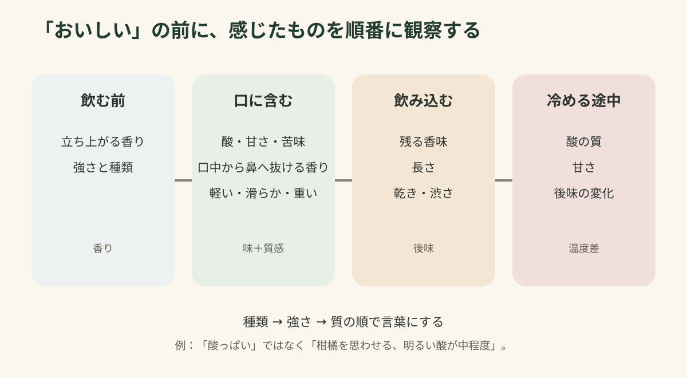

### 実践：四つの欄で記録する

1. 香り・フレーバー：花、柑橘、ベリー、ナッツ、カカオなど
2. 味：酸の種類、甘さ、苦味
3. 質感：軽い、滑らか、丸い、重い
4. 後味：残る香味、長さ、乾きや渋さの有無

## 第3章　産地は国名ではなく生育環境として読む

**到達目標**：緯度、標高、気温、雨、日照、微気候が生育へ関係する仕組みを説明できる。

主なコーヒー生産地は赤道を挟む熱帯・亜熱帯に分布します。しかし「熱帯だから同じ環境」ではありません。緯度、標高、海からの距離、斜面の向き、雲、風、雨季と乾季によって、農園周辺の気温、日照、水分条件は変わります。この狭い範囲に固有の条件を微気候と呼びます。

一般に標高が上がると気温は下がります。比較的低い気温では果実の成熟がゆっくり進むことがあり、成分形成の期間へ影響します。ただし「高標高なら必ず高品質」ではありません。同じ標高でも緯度や斜面、日照が違えば気温は異なり、品種が環境に適応しているか、樹が健康か、熟した実を選べたかも品質へ関係します。

雨は開花、果実の成長、収穫時期に影響します。日照は光合成と果実の成長に、土壌は根の発達、水分保持、養分利用に関係します。これらは単独で働くのではなく、品種と栽培管理を含む組み合わせとして働きます。したがって産地を読むときは、国から地域へ進み、標高、品種、精製、収穫期を重ねます。

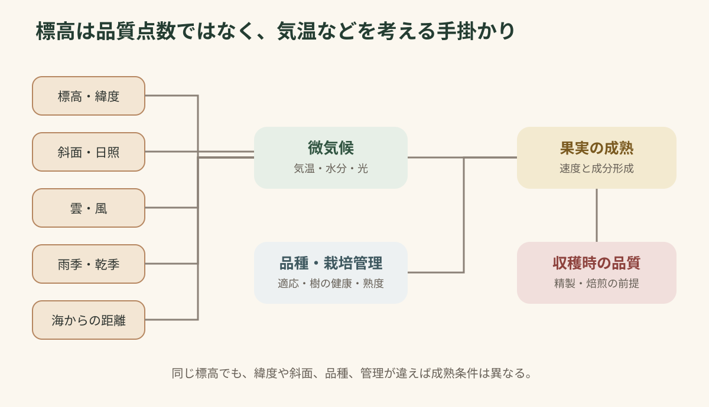

### 混同しやすい点

- 標高は品質点数ではなく、主に気温などを考える手掛かりである。
- 土壌の名前から、カップに同じ物質の味が直接移るわけではない。
- 国全体の平均気候と、一つの農園の微気候は同じではない。

## 第4章　収穫と精製を工程として理解する

**到達目標**：ウォッシュド、ナチュラル、ハニーの工程差と、発酵・乾燥管理の役割を説明できる。

精製とは、収穫したチェリーから保存・輸送できる生豆を作る工程です。名称を風味語として覚えるのではなく、果皮、果肉、粘液質をいつ除き、どの状態で乾燥させるかで区別します。

ウォッシュドは、果皮と果肉を除き、発酵や機械処理、洗浄などで粘液質を取り除いてから、パーチメントに包まれた種を乾燥します。パーチメントとは、種を包む薄く硬い殻で、日本語では内果皮とも呼ばれます。ナチュラルは、チェリーを果実のまま乾燥し、乾燥後に果皮や果肉を取り除きます。ハニーまたはパルプドナチュラルは、果皮を除いた後、粘液質の一部または全部を残して乾燥します。ハニーは蜂蜜を加える方法ではありません。

発酵はウォッシュドだけに存在するものではありません。収穫した果実や粘液質には微生物と酵素が関わり、時間、温度、酸素、水、容器、衛生状態によって進み方が変わります。生産者は、粘液質を除きやすくする、香味を設計する、過度な発酵や汚染を防ぐといった目的で条件を管理します。

乾燥の目的は、保存に適する水分状態へ均一に整えることです。乾燥層が厚すぎる、撹拌が不足する、雨や高湿度で乾燥が停滞するなどの問題は、カビ、好ましくない発酵、乾燥むら、保存中の劣化につながります。最終水分だけでなく、そこへ至る速度と均一性も重要です。

同程度の焙煎と抽出なら、ウォッシュドは香味を個別に識別しやすい印象、ナチュラルは熟した果実や発酵由来の香り、ハニーは甘さや丸い質感が見られる場合があります。しかし、これらは保証ではありません。同じナチュラルでも、品種、果実の熟度、発酵環境、乾燥日数、選別が違います。

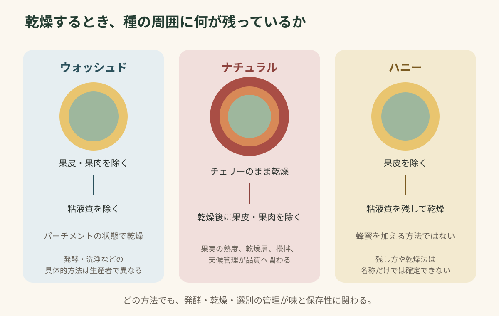

### 実践：精製差を飲み比べる

同じ農園または近い地域、同じ品種、近い焙煎度で、精製だけが異なる豆を選びます。香り、酸、甘さ、質感、後味を同じ順番で記録します。差を精製だけへ断定せず、そろえられなかった条件も残します。

## 第5章　焙煎は素材を加熱して香味を形成する

**到達目標**：焙煎による変化と、焙煎度が香味・抽出へ与える影響を説明できる。

生豆を加熱すると、水分が減り、豆が膨らみ、内部に細かな空隙が増えて、もろくなります。このように穴や空隙が多い構造を多孔質といいます。加熱中には、糖やアミノ酸などが関わって色と香りが生まれる褐変反応が進み、ナッツ、カラメル、カカオ、ロースト香など多くの香気が形成されます。焙煎は単に焦がす工程ではなく、生豆の特徴をどのように表現するかを設計する工程です。

浅い焙煎では、花、柑橘、果実など素材由来の特徴を識別しやすい傾向があります。焙煎が深くなると、酸の感じ方が穏やかになり、香ばしさ、カカオ、苦味など加熱由来の特徴が前に出やすくなります。また一般に、深く焙煎した豆ほど組織がもろく、成分が湯へ移りやすくなります。

浅煎り、中煎り、深煎りに世界共通の絶対的な境界はありません。同じ「中煎り」でも、焙煎店、豆、焙煎機、時間と温度の進め方で色と味は異なります。名称に加え、豆の色、店の説明、実際の味を確認します。

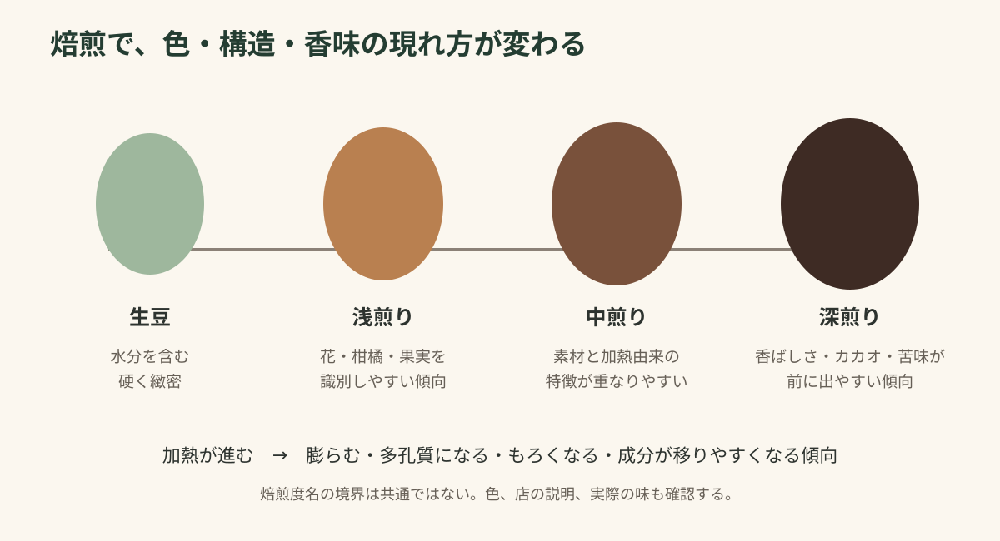

## 第6章　商品表示を情報の種類ごとに読む

**到達目標**：由来、植物、精製、焙煎、等級、風味説明を分類できる。

商品表示は、一行の物語として読む前に情報の種類へ分解します。「コロンビア／ウイラ／○○農園」は、国、地域、農園です。区画、収穫日、品種、精製単位などで分けたロットが加わることもあります。由来が細かいことは品質の自動保証ではありませんが、同じ豆を追跡し、再購入し、条件を比較する精度を高めます。

「カトゥーラ／ウォッシュド／浅煎り」は、品種、精製、焙煎度です。AA、SHBなどの等級は国や制度によって意味が異なり、豆の大きさ、栽培標高、欠点などを区分する場合があります。世界共通の風味点数ではなく、等級だけから品種や精製を確定することもできません。

フレーバーノートは、香料や原材料の表示ではなく、そのコーヒーから連想されやすい香味の説明です。表示されていない情報は推測で埋めず、不明として残すか店へ尋ねます。

シングルオリジンは、国、地域、農園、協同組合など、一定の由来でまとめたコーヒーです。どの範囲を指すかは商品ごとに確認します。ブレンドは、複数の豆を目的に合わせて組み合わせたものです。単一由来が常に上位という関係ではなく、追跡して比較したいならシングルオリジン、安定した味や用途への適性を重視するならブレンドも有力です。

デカフェは、焙煎前の生豆からカフェインの大部分を除いたコーヒーです。カフェインが完全にゼロとは限りません。表示があれば、水、二酸化炭素、有機溶媒など、どの方法で除去したかを工程情報として読みます。方法名だけで味を決めず、元の豆、焙煎度、鮮度も確認します。

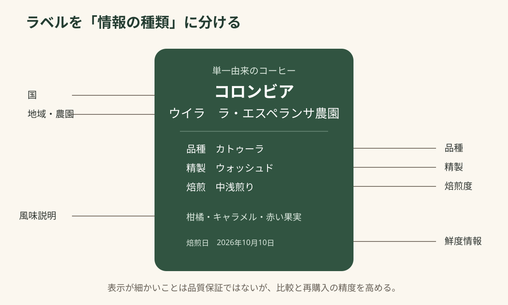

### 購入時の読み順

1. 焙煎度で大きな方向を確認する。
2. 風味説明を、香り・酸・甘さ・質感へ分ける。
3. 地域、品種、精製から、その説明の背景を読む。
4. 飲み方と避けたい強さを照合する。
5. 再購入したい場合は農園・精製所、ロット、収穫期も記録する。

### 表示を読んだ結果の例

「コロンビア／ウイラ／カトゥーラ／ウォッシュド／中浅煎り」は、国、地域、品種、精製、焙煎度が順に示されています。ここから特定の味を確定するのではなく、「中浅煎りとウォッシュドで、果実の香りと酸の質を観察する」と、確認できる項目へ変換します。

## 第7章　まず一杯淹れるための基準レシピ

**到達目標**：主要な抽出条件を測り、同じ一杯を再現できる。

この章は、第3部を学ぶ前に実際の一杯を作るためのクイックスタートです。詳しい調整理由は第3部で扱います。

最低限必要なものは、ドリッパー、対応するフィルター、サーバーまたはカップ、ケトル、はかり、タイマー、グラインダーです。器具は乾いた状態で組み立て、紙フィルターは器具の説明に従ってセットします。湯でフィルターと器具を温めた場合は、たまった湯を捨ててから粉を入れます。

ハンドドリップでは、粉量、総注湯量、粉と湯の比率、挽き目、湯温、抽出時間、注湯の分け方を記録します。たとえば粉15 gに湯240 gなら、粉1に対して湯16の「1:16」です。中挽き、90〜93 ℃、約3分は出発点になり得ますが、すべての豆と器具に共通する正解ではありません。

水の成分は抽出と味へ影響します。最初は強いにおいのない飲用水を使い、毎回同じ水で比較してください。水を変えた日はレシピにも記録します。また、焙煎日、開封日、保管状態が違えばガスの量や香りも変わります。豆は高温、多湿、光、酸素を避け、密閉できる容器で保管します。冷蔵庫への出し入れで結露させないことも重要です。

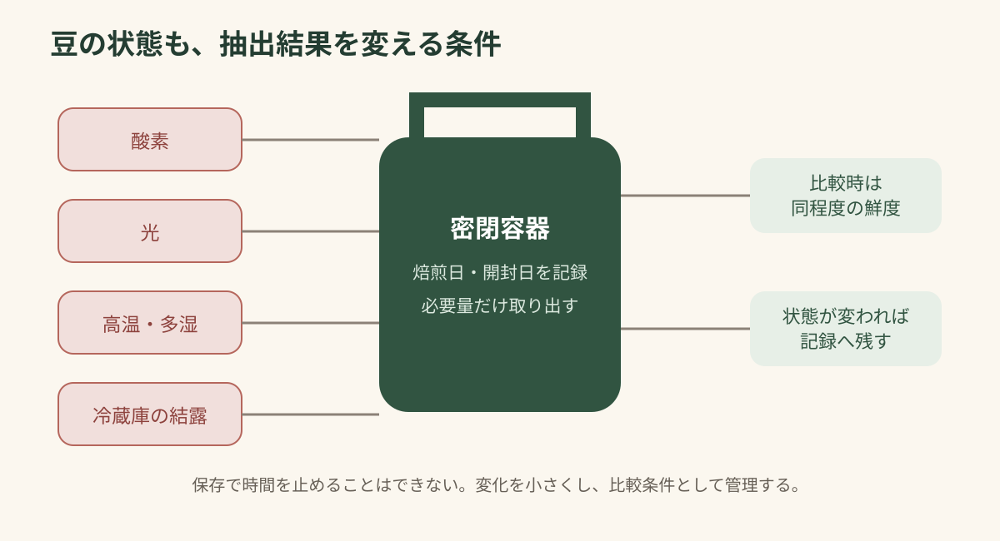

蒸らしでは粉全体へ湯を届け、焙煎豆に残るガスを逃がします。本抽出では、各投の湯量、開始時刻、終了時刻をそろえると流量を再現できます。落ち切り時間は、挽き目、微粉、粉量、注ぎ、ドリッパー、フィルターが合わさった結果でもあります。

最初の一杯は正解ではなく、比較の基準です。味と数値を記録し、次は一項目だけを変えます。良い一杯ができたら同条件でもう一度淹れ、偶然ではなく再現できるか確かめます。

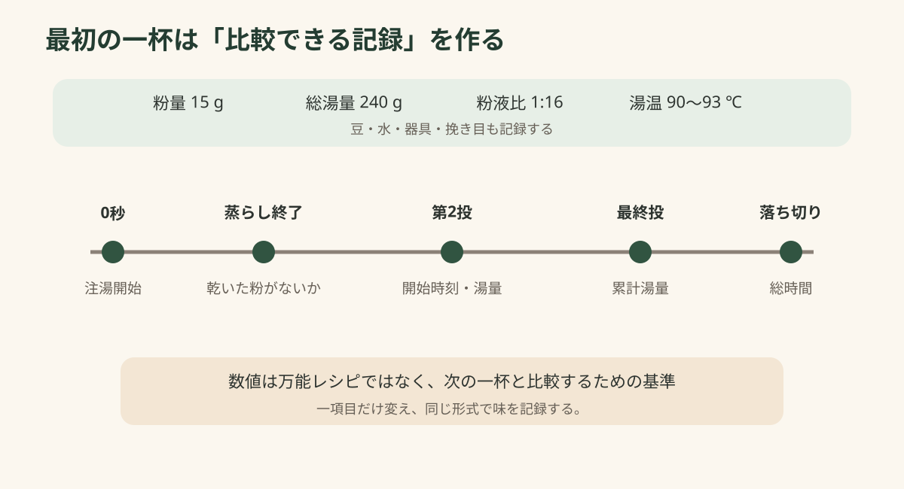

---

# 第2部　世界の産地を読む

## 第8章　産地情報を読むための共通原則

**到達目標**：国名から味を断定せず、地域・品種・精製・焙煎を重ねて比較できる。

産地は「味の答え」ではなく、生育と生産の条件を調べるための住所です。国の中には複数の地域、標高帯、微気候、品種、精製方法があります。同じ国の豆でも風味が大きく異なり、異なる国の豆に似た特徴が現れることもあります。

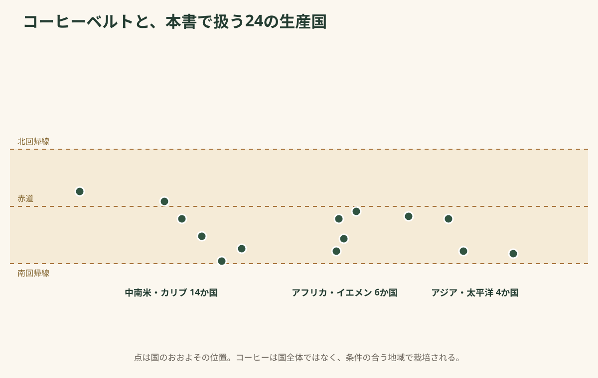

比較するときは、違いを見たい条件以外をできるだけ近づけます。地域差を見たいなら、焙煎度、精製、抽出条件を近づけます。精製差を見たいなら、農園・地域、品種、焙煎度を近づけます。完全に条件を一致させられなくても、何が違うかを明記すれば、結論を過度に一般化せずに済みます。

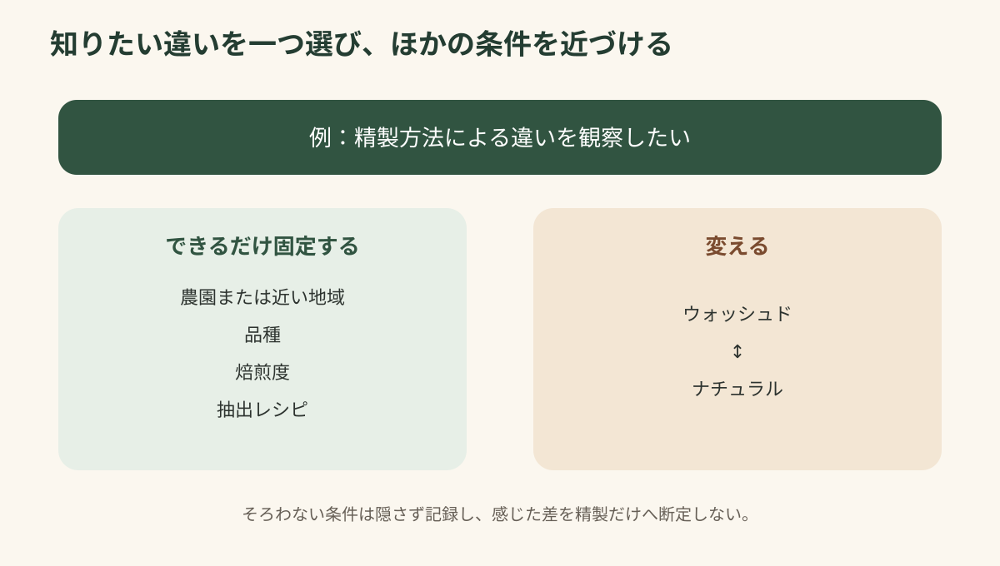

品種は、品質、収量、樹形、病害抵抗性、成熟時期などの可能性に関係します。ただし、同じ品種名でも系統や環境が異なる場合があります。とくに「在来系統」「カティモール」など広い群を示す表記は、単一品種のように扱わず、より具体的な情報があるか確認します。

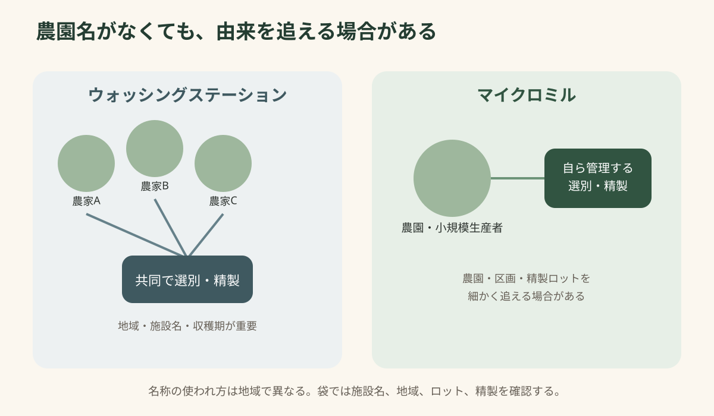

## 第9章　中南米の産地

中南米では、アンデス山脈、火山性高地、大規模な平坦地など多様な環境でコーヒーが作られています。ナッツ、カカオ、キャラメル、柑橘、果実といった言葉がよく使われますが、国ごとの固定味ではありません。地域と精製を確認します。

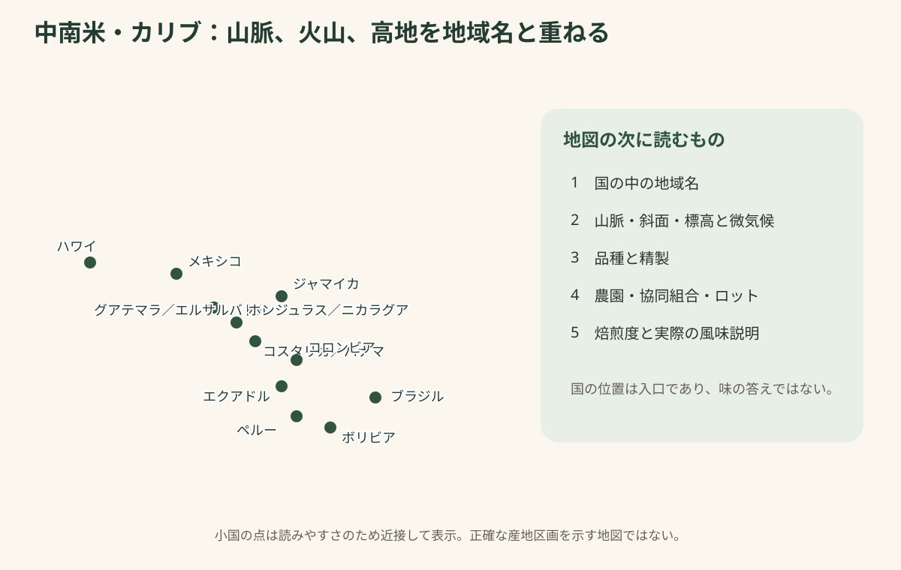

### ブラジル

**地理と地域**：広い国土に、平坦な大規模農園から山地の小規模区画まであります。セラード・ミネイロ、南ミナス、モジアナなどを区別します。

**品種と生産**：ムンドノーボ、カトゥアイ、ブルボンなどが見られます。果実のまま乾燥するナチュラル、果皮を除いて粘液質を残すパルプドナチュラルが重要で、地形に応じて機械収穫と手摘みが使い分けられます。

**風味傾向と選び方**：同程度の焙煎なら、ナッツ、チョコ、キャラメル、熟した果実が見られることがあります。地域と精製を確認し、穏やかな酸と香ばしい甘さを求めるのか、果実感を求めるのかを分けます。

### コロンビア

**地理と地域**：アンデス山脈に沿って産地が南北へ広がり、地域によって収穫期も異なります。ウイラ、ナリーニョ、サンタンデールを同じ環境として扱いません。

**品種と生産**：カスティージョ、コロンビア、カトゥーラなどが栽培され、ウォッシュドが広く用いられます。小規模生産者やロット単位の表示も多く見られます。

**風味傾向と選び方**：ウイラでは果実やキャラメル、ナリーニョでは繊細な酸と甘さ、サンタンデールではチョコ、ナッツ、ハーブが紹介されます。国名だけでなく、地域、品種、精製を確認します。

### ペルー

**地理と地域**：アンデス東斜面を中心に小規模生産が広がり、北部のカハマルカ、中部のフニン、南部のクスコでは環境が異なります。

**品種と生産**：カトゥーラ、ティピカ、ブルボンなどが見られ、ウォッシュドが中心です。協同組合は集荷、品質管理、輸出で重要な役割を持ちます。

**風味傾向と選び方**：カハマルカでは柑橘とカカオ、クスコでは花と繊細な果実、フニンでは果実と丸い質感が紹介されます。まず地域名を確認し、甘さの方向を尋ねます。

### ボリビア

**地理と地域**：アンデス高地からユンガスの斜面へ下る限られた生産地で、標高差が大きい国です。ユンガス、カラナビ、サマイパタを区別します。

**品種と生産**：ティピカ、カトゥーラ、カトゥアイなどが見られ、ウォッシュドが重要です。山地からの輸送条件は、収穫後の品質維持にも関係します。

**風味傾向と選び方**：花、柑橘、透明感、甘い果実、滑らかな質感などが紹介されます。希少性だけで選ばず、地域、品種、精製が追跡できるロットを選びます。

### エクアドル

**地理と地域**：赤道直下でも、アンデス、沿岸、島嶼部で環境は異なります。ロハ、ピチンチャ、サモラ・チンチペなどが手掛かりです。

**品種と生産**：ティピカ、ブルボン、シドラなどが見られ、農園単位の小規模なウォッシュドロットも流通します。赤道からの距離だけでなく、標高と微気候を読みます。

**風味傾向と選び方**：花、柑橘、赤い果実、糖蜜を思わせる甘さ、カカオ、丸い質感などが紹介されます。地域と標高を一緒に確認します。

### グアテマラ

**地理と地域**：火山、高原、雨の多い地域が近接しています。アンティグア、ウエウエテナンゴ、アティトランでは、風、標高、湖など生育条件が異なります。

**品種と生産**：ブルボン、カトゥーラ、カトゥアイなどが栽培され、ウォッシュドが代表的です。地域名が商品表示へ出やすいので、国名の次に読みます。

**風味傾向と選び方**：アンティグアではカカオとスパイス、ウエウエテナンゴでは明るい果実と花、アティトランでは柑橘とチョコが紹介されます。重厚な方向か、明るい果実方向かを地域とともに選びます。

### エルサルバドル

**地理と地域**：国土は小さいものの、火山性の山地に複数の産地があります。アパネカ・イラマテペック、アロテペック・メタパン、テカパ・チナメカを区別します。

**品種と生産**：ブルボンに加え、その自然変異であるパカス、パカスとマラゴジッペの交配であるパカマラが重要です。ウォッシュドが中心ですが、精製はロットごとに確認します。

**風味傾向と選び方**：花、柑橘、カカオ、キャラメル、丸い甘さなどが紹介されます。パカマラという品種名だけで決めず、地域、精製、焙煎度も読みます。

### ホンジュラス

**地理と地域**：複数の山地に生産が広がるため、コパン、モンテシージョス、アガルタなど地域差を確認します。

**品種と生産**：カトゥアイ、パカス、IHCAFE 90などが栽培され、ウォッシュドが中心です。生産者や小規模区画まで追跡できるロットも増えています。

**風味傾向と選び方**：コパンではカカオとキャラメル、モンテシージョスでは柑橘と桃、アガルタでは南国果実とチョコが紹介されます。希望する香味を地域候補へ変え、精製と焙煎度で絞ります。

### コスタリカ

**地理と地域**：火山性山地に産地が分かれ、タラス、ウエストバレー、ブルンカなどがあります。

**品種と生産**：カトゥーラ、カトゥアイ、ビジャサルチなどが見られます。生産者側で精製を管理するマイクロミルと、多様なハニー精製が重要です。

**風味傾向と選び方**：柑橘と透明感、蜂蜜を思わせる甘さと果実、カカオと熟した果実などが紹介されます。ハニーの色名だけで決めず、粘液質の残し方、乾燥管理、地域を確認します。

### パナマ

**地理と地域**：西部チリキ県の高地を中心に、ボケテ、ボルカン、レナシミエントなどがあります。農園や区画単位の細かな管理が見られます。

**品種と生産**：ゲシャ、カトゥーラ、カトゥアイなどが栽培され、ウォッシュドとナチュラルの双方が流通します。希少性と評価による価格差も大きい市場です。

**風味傾向と選び方**：ゲシャではジャスミン、柑橘、紅茶が紹介されますが、品種名だけで完成した味や品質は決まりません。農園、区画、精製、焙煎度を確認します。

### ニカラグア

**地理と地域**：北部山地を中心に、ヌエバ・セゴビア、ヒノテガ、マタガルパなどがあります。

**品種と生産**：カトゥーラ、ブルボン、マラカトゥーラなどが見られ、ウォッシュドが中心です。大粒品種もありますが、粒の大きさだけで品質は決まりません。

**風味傾向と選び方**：花と明るい果実、カカオと柑橘、ナッツと丸い甘さなどが紹介されます。大粒という外観より、地域、品種、精製の組み合わせを読みます。

### メキシコ

**地理と地域**：南部を中心に広い生産地を持ちます。チアパス、ベラクルス、オアハカでは標高、文化、生産体制が異なります。

**品種と生産**：ティピカ、ブルボン、マルセレサなどが見られ、ウォッシュドと小規模生産者の共同出荷が重要です。

**風味傾向と選び方**：カカオと柑橘、ナッツとスパイス、チョコと花などが紹介されます。「メキシコ」だけでなく、南部のどの地域かを確認します。

### ハワイ

**地理と地域**：島ごとに火山性土壌、風、雨が異なり、コナ、カウ、マウイを区別します。高い生産費も価格へ反映されます。

**品種と生産**：ティピカはコナで歴史的に重要で、カトゥーラやモカなども見られます。ウォッシュド以外の精製も行われます。

**風味傾向と選び方**：コナではキャラメルとナッツ、カウでは果実とカカオ、マウイでは花と南国果実が紹介されます。「コナ・ブレンド」と「コナ100%」の表示差を確認します。

### ジャマイカ

**地理と地域**：ブルーマウンテン山脈の限定地域は原産地表示と品質管理で知られます。ハイマウンテンや低標高地域とは表示上も区別します。

**品種と生産**：ティピカが中心で、一部ではゲイシャや病害対策の交配系統も見られます。樽包装は伝統的な輸出形態として知られます。

**風味傾向と選び方**：穏やかな酸、清潔感、ナッツ、カカオなどが紹介されます。高価格は限定性とブランド価値にも影響されるため、名称だけで決めず、認証、農園、焙煎日を確認します。

### 中南米を比較する早見表

| 比較の入口 | 候補 | 次に確認する情報 |
|---|---|---|
| 香ばしい甘さと穏やかな酸 | ブラジル、メキシコ、コパン地域 | 精製、焙煎度、地域 |
| 花や明るい果実 | ナリーニョ、ウエウエテナンゴ、ヌエバ・セゴビア | 品種、標高、精製 |
| 精製違いを比べたい | ブラジル、コスタリカ、パナマ | 同じ農園・品種の別精製があるか |
| 由来を細かく追いたい | パナマ、コスタリカ、コロンビア | 農園、区画、マイクロミル、ロット |
| 名称や価格の影響を分けたい | コナ、ブルーマウンテン、ゲシャ | 認証、含有率、農園、収穫期 |

この表は国別の味を保証する一覧ではありません。購入候補を作り、袋の詳細を読む順番を示すものです。

## 第10章　アフリカとイエメンの産地

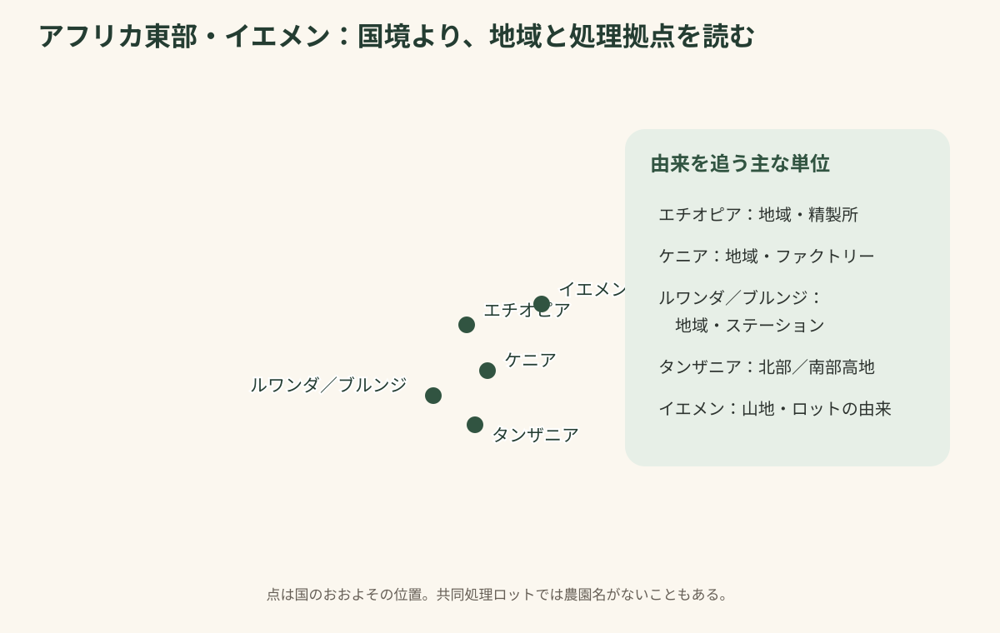

### エチオピア

**地理と地域**：アラビカの起源地で、イルガチェフェ、グジ、シダマなど地域ごとに標高、気候、生産文化が異なります。

**品種と生産**：地域で受け継がれた多様な在来系統、JARCが選抜した74110などの系統があります。多数の小農家のチェリーを集める精製所ロットもあるため、農園名がないことを低品質の意味にはしません。

**風味傾向と選び方**：ウォッシュドでは花、柑橘、紅茶、ナチュラルではベリーや熟した果実が見られる場合があります。地域と精製を必ず組み合わせて読みます。

### ケニア

**地理と地域**：赤道付近の高地に、ニエリ、キリニャガ、エンブなどの産地があります。小農家のチェリーを集めるファクトリー名も重要な由来です。

**品種と生産**：SL28、SL34、ルイル11、バティアンなどが栽培され、発酵後の洗浄や浸漬を含むウォッシュド工程が見られます。AAなどの等級は主に豆の大きさに関する区分です。

**風味傾向と選び方**：黒スグリ、赤い果実、柑橘、花、みずみずしい酸などが紹介されます。AAを品質点数として扱わず、地域、ファクトリー、品種、収穫期を確認します。

### ルワンダ

**地理と地域**：起伏の多い高地に、ニャマシェケ、フイエ、ガケンケなどの産地があります。

**品種と生産**：レッドブルボン、ジャクソン、国内研究機関の選抜系統などが見られます。小農家のチェリーをウォッシングステーションへ集め、選別・精製する形が重要です。

**風味傾向と選び方**：柑橘、紅茶、花、赤い果実、蜂蜜を思わせる甘さなどが紹介されます。農園名がなくても、地域、ステーション、精製を由来として読みます。

### ブルンジ

**地理と地域**：高地の小規模農家とウォッシングステーションを中心に生産されます。カヤンザ、ンゴジ、ムインガなどを区別します。

**品種と生産**：レッドブルボン、ジャクソン、ミビリジなどが見られ、ウォッシュドが主要な輸出ロットで多く使われます。

**風味傾向と選び方**：柑橘と花、赤い果実と紅茶、蜂蜜を思わせる甘さと丸い質感などが紹介されます。県名とステーション名の両方を確認します。

### タンザニア

**地理と地域**：北部の火山斜面と南部高地が離れており、キリマンジャロ、ムベヤ、ムビンガなどで気候と収穫期が異なります。

**品種と生産**：ブルボン系、ケント、N39などが見られ、ウォッシュドが重要です。ピーベリーは丸豆の形状で、地域名や品質等級ではありません。

**風味傾向と選び方**：北部では柑橘と花、ムベヤでは赤い果実、ムビンガではカカオと丸い質感などが紹介されます。「キリマンジャロ」「ピーベリー」だけでなく、具体的な地域と精製を確認します。

### イエメン

**地理と地域**：乾燥した山岳地帯の段々畑で栽培され、ハラーズ、バニ・マタル、ハイマなどがあります。水が限られる環境と小規模生産が背景です。

**品種と生産**：ウダイニ、ダワイリなど現地で区別される多様な在来系統があり、伝統的なナチュラル精製が中心です。流通時に地域が混ざる場合もあるため、ロットの由来を確認します。

**風味傾向と選び方**：乾燥果実、スパイス、カカオ、花、ワインを思わせる香りなどが紹介されます。モカは港名・歴史的呼称として使われてきたため、品種名やチョコ味の意味だけに限定しません。

### アフリカとイエメンを比較する早見表

| 比較の入口 | 候補 | 次に確認する情報 |
|---|---|---|
| 花・柑橘・紅茶の方向 | エチオピア、ルワンダ、ブルンジ | 地域、精製所、ウォッシュドか |
| 赤い果実やみずみずしい酸 | ケニア、ルワンダ、タンザニア南部 | 地域、品種、焙煎度 |
| ナチュラルの違い | エチオピア、イエメン | 品種・系統、乾燥、ロットの由来 |
| 共同処理ロットを読む | ケニア、ルワンダ、ブルンジ | ファクトリー／ステーション、地域、収穫期 |

農園名がないことと、由来が分からないことは同じではありません。共同処理では、精製所名や地域名が重要な追跡情報になります。

## 第11章　アジア・太平洋の産地

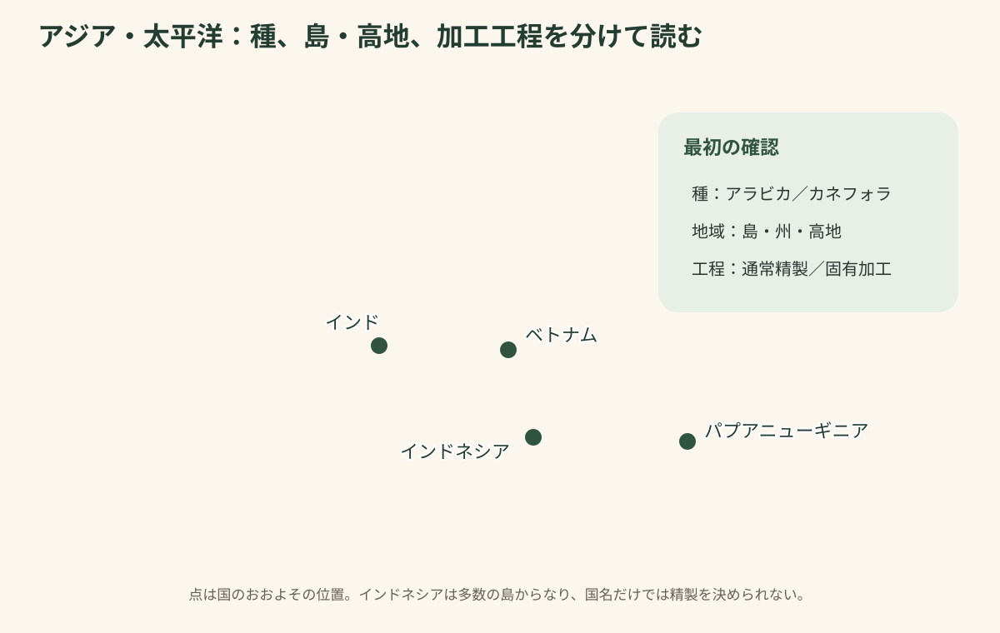

### インドネシア

**地理と地域**：多数の島に産地が分かれます。スマトラのアチェ・ガヨやリントン、ジャワ、バリ、スラウェシを同じ環境として扱いません。

**品種と生産**：ティピカ系、カティモール系、S795などが見られます。スマトラ式は、通常より高い水分を残したパーチメントで脱殻し、その後に乾燥を続ける工程です。ジャワやバリではウォッシュドなども行われます。

**風味傾向と選び方**：重い質感、ハーブ、スパイス、杉、カカオなどが紹介されます。インドネシア産がすべてスマトラ式ではないため、島・地域と精製を確認します。

### ベトナム

**地理と地域**：中部高原はカネフォラ生産の中心で、ダラット、ソンラなどの高地ではアラビカも栽培されます。

**品種と生産**：国内生産の中心であるカネフォラに加え、アラビカ系のカティモール、ティピカなどが見られます。量産カネフォラでは乾式精製、高地アラビカではウォッシュドなども流通します。

**風味傾向と選び方**：カネフォラではカカオや力強い苦味、高地アラビカでは果実、花、柑橘、茶などが紹介されます。最初に種を確認し、焙煎度と用途を読みます。

### インド

**地理と地域**：南部の木陰栽培を中心に、チクマガルール、クールグ、ニルギリなどがあります。

**品種と生産**：S795、ケントなどのアラビカ品種とカネフォラの双方が栽培されます。樹木の下での栽培、スパイス作物との混植も見られます。モンスーン加工は、生豆を湿った季節風へさらす工程です。

**風味傾向と選び方**：スパイス、カカオ、ナッツ、重い質感、花、柑橘などが紹介されます。「モンスーン加工」を産地や品種ではなく加工工程として読み、種と地域も確認します。

### パプアニューギニア

**地理と地域**：険しい山地に小規模農家が多く、東部高地、西部高地、モロベなどで環境が異なります。

**品種と生産**：ティピカ系、ブルボン系、アルーシャなどが栽培され、ウォッシュドが中心です。小農家の共同処理ロットと、独立農園が精製・輸出するロットがあります。

**風味傾向と選び方**：果実、花、カカオ、柑橘、明るい酸、丸い質感などが紹介されます。国名だけでなく、州、農園または精製所名、精製を確認します。

### アジア・太平洋を比較する早見表

| 比較の入口 | 候補 | 次に確認する情報 |
|---|---|---|
| 種の違いを学ぶ | ベトナム、インド | アラビカかカネフォラか、用途、焙煎度 |
| 特有の加工を学ぶ | インドネシア、インド | スマトラ式か、モンスーン加工か、通常精製か |
| 地域差を学ぶ | インドネシア、パプアニューギニア | 島・州、農園または精製所、精製 |
| 重い質感と明るい果実を比べる | スマトラと高地アラビカ | 種、精製、焙煎度を近づけられるか |

## 第12章　産地知識を購入と比較へ使う

袋から味を予想するときは、地域、品種、精製、焙煎度、風味説明を別々に抜き出します。そのうえで「浅煎りとウォッシュドなので、柑橘を思わせる明るい酸が見られるかもしれない」のように、根拠と観察項目を結び付けます。「必ず」「この国だから」とは書きません。

反対に、味から産地を一つに当てることも目的ではありません。花と柑橘を感じたなら、浅めの焙煎、ウォッシュド、特定の品種や地域など複数候補を残し、袋の表示と照合します。味は答え合わせではなく、条件を絞る観察です。

店員へ相談するときは、「フルーティーな豆」だけでなく、「柑橘系か熟したベリー系か」「酸は鋭いか丸いか」「質感は軽いか重いか」「ブラックかミルクか」を伝えます。前回の豆名と、そこから何を増減したいかを示すと、比較可能な提案を受けやすくなります。

---

# 第3部　ハンドドリップを設計する

## 第13章　濃度と抽出度を分ける

**到達目標**：濃い・薄いと、抽出不足・抽出過多を別々に診断できる。

濃度は、出来上がった液体にどれくらい成分が溶けているかという「飲み物側」の尺度です。粉と湯の比率が大きく関係します。抽出度は、使った粉の成分のうちどれくらいが液体へ移ったかという「粉側」の尺度です。挽き目、湯温、接触時間、攪拌、流れなどが関係します。

二つは同じではありません。湯を多くすれば液体は薄くなりやすい一方、粉から取り出す割合は増える場合があります。少ない湯で濃く作っても、短時間で流れれば抽出不足になることがあります。微粉や偏流があれば、全体は薄いのに一部が強く抽出され、乾いた渋さを伴うこともあります。

「薄いから抽出不足」「苦いから過抽出」と一語で決めず、まず濃度が適切か、その次に酸・甘さ・苦味・渋さのバランスを見ます。

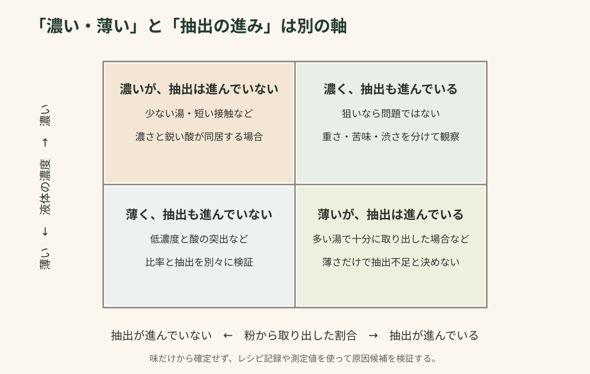

測定器があれば、濃度はTDS（液体中の溶解成分の割合）、抽出度は粉から取り出した割合として数値化できます。ただし家庭では、味とレシピ記録から状態を推定する場合が多く、その診断は確定値ではありません。「抽出不足らしい」「不均一な抽出の可能性がある」のように、検証可能な候補として扱います。

## 第14章　粉と湯の比率を設計する

粉液比は、粉量に対する総注湯量の比です。粉15 gに湯240 gなら1:16、湯225 gなら1:15、湯255 gなら1:17です。同じ粉量なら、湯を減らすほど濃い方向、増やすほど薄い方向へ動きやすくなります。

ただし比率は濃度だけのつまみではありません。湯量が変わると粉を通過する水の量と接触も変わり、抽出度へ影響することがあります。濃さだけを少し上げたいなら、まず比率を小さく動かし、挽き目や湯温を同時に変えません。出来上がり量を増やすときは、粉量と湯量を同じ割合で増やせば比率は保てますが、粉層が厚くなり流れが変わる可能性があります。

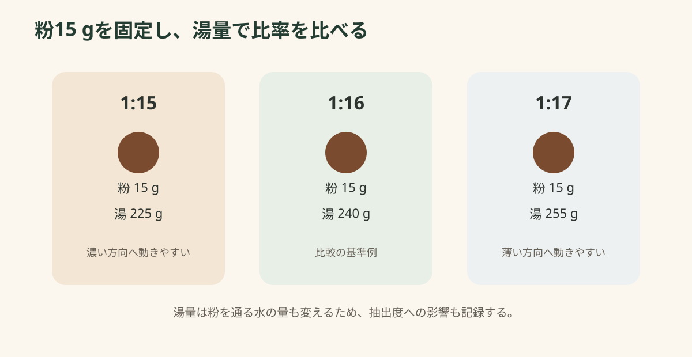

## 第15章　挽き目と粒度分布を理解する

細かく挽くと総表面積が増え、粉層の抵抗も増えるため、一般に抽出は進み、流れは遅くなりやすくなります。粗く挽くと表面積と抵抗が減り、流れは速くなりやすくなります。ただし「目盛り」だけで結果は決まりません。

実際の粉には、狙った大きさの粒だけでなく、細かな微粉と大きな粒が混ざります。微粉は速く抽出され、フィルターや粒の隙間を塞いで流れを遅くすることがあります。大きな粒は中心まで湯が届きにくく、抽出不足になりやすい場合があります。この粒の広がりが粒度分布です。

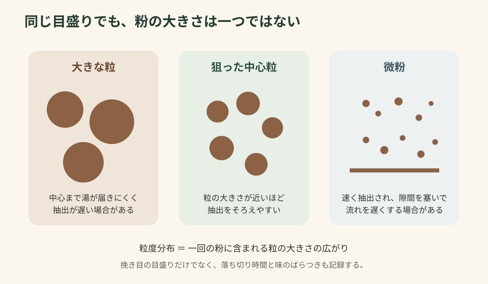

同じ目盛りでも抽出が安定しない場合は、同じ豆を複数回挽き、微粉・粗い粒の見え方、抽出時間、味のばらつきを記録します。グラインダーの清掃、刃の状態、投入方法も確認します。

## 第16章　湯温と時間を原因・結果の両面から見る

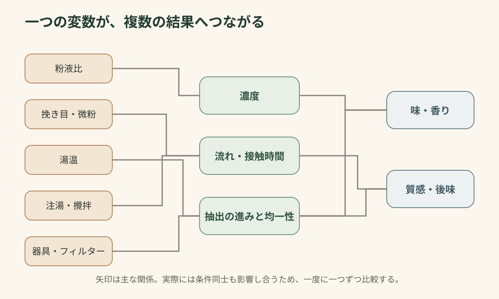

湯温が高いほど、多くの成分が溶ける速度は一般に上がります。浅煎りのように成分が移りにくい豆では高めの湯温、深煎りのように成分が移りやすい豆では低めの湯温が調整候補になります。ただし「高温だから酸が減る」「低温だから苦味が減る」と直接決めません。濃度と抽出度を同程度にそろえた研究では、87〜93 ℃の範囲で湯温そのものによる官能差が小さかった例もあります。温度は主に抽出の進み方を変える変数として、挽き目、時間、攪拌と組み合わせて考えます。

抽出時間は重要ですが、独立した操作つまみではありません。挽き目、微粉、粉量、注湯、ドリッパー、フィルターの結果としても変わります。前回より30秒長かった場合、「時間が原因」とだけ考えず、なぜ流れが遅くなったかを調べます。

湯温の影響を見たいなら、他条件をそろえて2℃程度だけ動かします。流れが遅く乾いた渋さがあるなら、同じレシピで挽き目だけを一段粗くするなど、直接関係する変数を一つ選びます。

## 第17章　注湯と蒸らしで粉層を整える

注湯は、総湯量だけでなく、各投の湯量、流量、高さ、位置、回数、投と投の間隔から成ります。高い位置から強く注ぐと、粉層への衝撃と攪拌が増え、微粉の移動や流路が変わることがあります。中心だけへ注ぐ場合と外側まで広げる場合でも、濡れ方は変わります。

蒸らしの目的は、粉全体を濡らし、ガスを逃がし、本抽出の湯が偏りにくい状態を作ることです。目安として粉量の2〜3倍程度の湯を使う方法がありますが、焙煎からの日数、焙煎度、挽き目で必要量は変わります。蒸らし後に乾いた粉が残るなら、湯量、注ぐ位置、軽い揺すりを見直します。待ち時間を延ばすだけでは、湯が触れていない粉は濡れません。

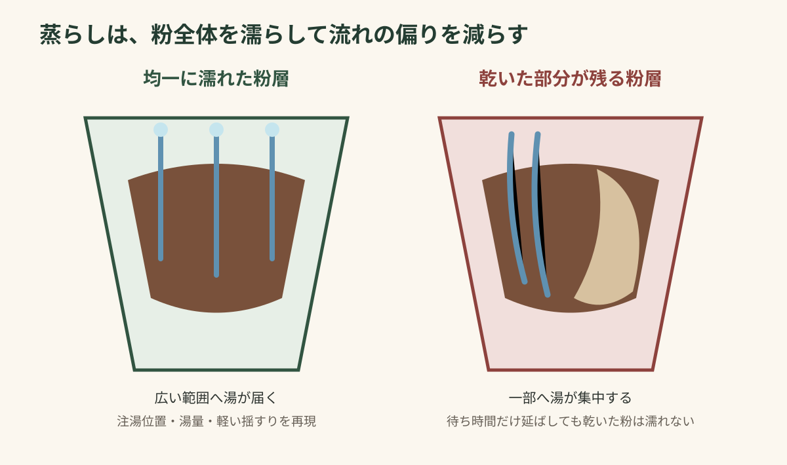

再現のため、各投の開始時刻、終了時刻、湯量を記録します。これにより投ごとの流量と間隔を比較できます。

## 第18章　器具とフィルターの違いを流れとして捉える

円すい型、平底型、台形型という分類だけで味は決まりません。穴の数と大きさ、リブ、底面、フィルターの密着、紙の厚さ、粉層の深さ、注ぎ方が組み合わさって流れを作ります。同じ円すい型でも製品によって流速は異なります。

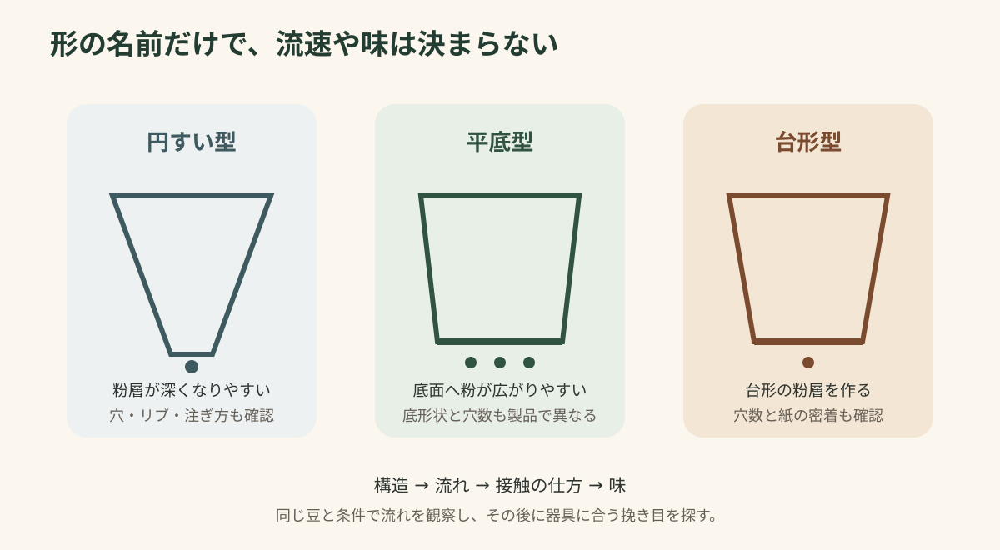

紙フィルターは油分と微粒子を保持しやすく、比較的澄んだ質感になりやすい傾向があります。金属フィルターは油分と微粒子を通しやすく、質感が豊かになりやすい傾向があります。どちらが上位という関係ではなく、欲しい質感と手入れ、再現性で選びます。

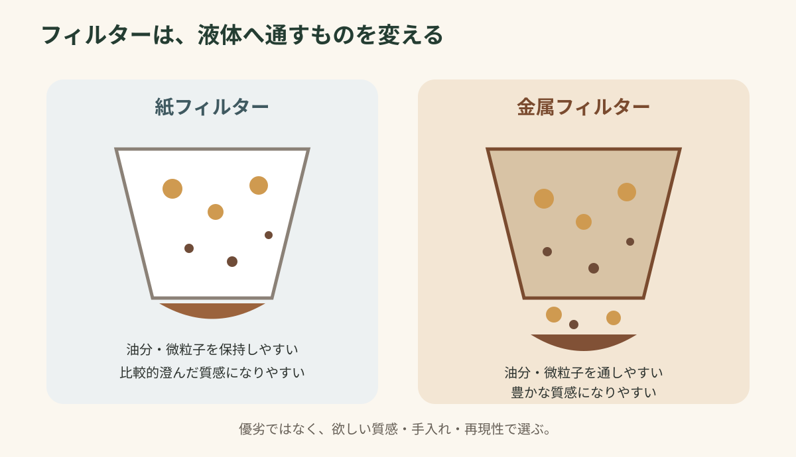

器具差を比べる場合も、同じ豆、粉量、湯量、湯温、できるだけ近い挽き目を使い、流れと味を記録します。器具が変わると適する挽き目も変わるため、一回の結果で器具の性格を固定しません。

## 第19章　味を診断して次の一手を選ぶ

調整は、症状を一語で決めるのではなく、濃度と抽出状態を分けて行います。

### 薄いが、酸が突出して甘さが乏しい

低濃度と抽出不足が同時に起きている可能性があります。まず、どちらを優先して確かめるか決めます。濃度だけを上げたいなら、比率を濃い方向へ小さく動かします。ただし湯量を減らすと抽出が進みにくくなる場合があります。甘さを増やして酸の突出を抑えたいなら、比率を保ったまま挽き目を少し細かくするなど、抽出を進める変更を別の一杯で試します。一杯の中で両方を変えると、どちらが効いたか分かりません。

### 濃さはよいが、酸が鋭く甘さが乏しい

濃度は保ち、抽出を進める方向を検討します。挽き目を一段細かくする、湯温を少し上げる、接触を少し増やす候補から一つを選びます。

### 濃さはよいが、乾いた渋さがある

強すぎる抽出だけでなく、不均一な抽出、微粉の詰まり、過度な攪拌、偏流を疑います。落ち切りが遅いなら、まず挽き目を一段粗くして時間と味を比較します。

### 苦味とロースト香が強い

深い焙煎由来の特徴か、抽出で強めたのかを分けます。豆自体が深煎りなら、湯温を下げる、接触を穏やかにする候補があります。浅煎りなのに重い苦味が出たなら、微粉、時間、攪拌を確認します。

### 味が毎回変わる

計量、グラインダーの粒度分布、注湯の流量、蒸らしの濡れ方、器具の予熱を確認します。平均値だけでなく、同条件を数回繰り返したときのばらつきを見ます。

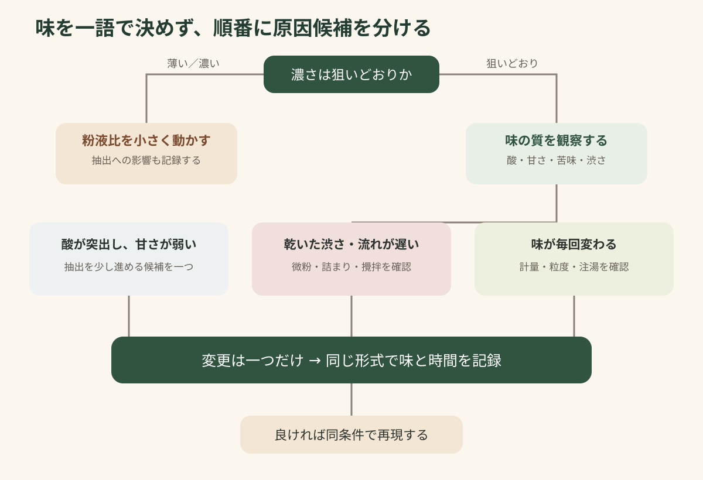

## 第20章　自分のレシピを作る

レシピ作りは、正解の数字を探す作業ではなく、「狙う味→基準→観察→一変数変更→再現」の循環です。

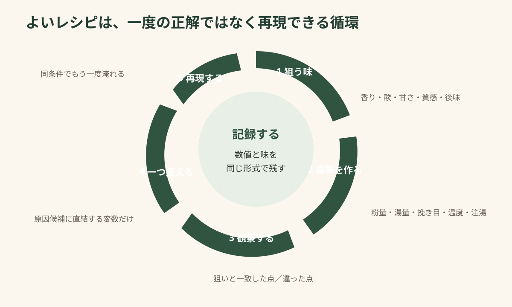

### 1. 狙う味を決める

「おいしく」ではなく、「柑橘の香り、明るい酸、軽い質感、甘い後味」のように観察可能な言葉で書きます。

### 2. 基準レシピを決める

- 豆と焙煎日
- 粉量
- 総注湯量と粉液比
- グラインダーと目盛り
- 湯温
- 蒸らし湯量と時間
- 各投の時刻と湯量
- 落ち切り時間
- 使用器具とフィルター

### 3. 味を四つの欄で記録する

香り・フレーバー、味、質感、後味を記録します。狙いと一致した点、異なった点を分けます。

### 4. 一つだけ変える

薄さを変えたいのか、抽出を進めたいのか、流れの偏りを減らしたいのかを決め、直接関係する変数を一つ選びます。変更幅も記録します。

### 5. 良い条件を再現する

一度良かっただけでは基準レシピになりません。同じ条件でもう一度淹れ、近い結果が得られるか確かめます。再現しなければ、計量や注湯、粒度分布など、ばらつきの原因を調べます。

### レシピ記録例

| 項目 | 基準 | 次の変更 |
|---|---:|---:|
| 粉量 | 15 g | 15 g |
| 注湯量 | 240 g | 240 g |
| 粉液比 | 1:16 | 1:16 |
| 湯温 | 92 ℃ | 92 ℃ |
| 挽き目 | 中挽き | 一段細かく |
| 蒸らし | 40g・40秒 | 同じ |
| 総抽出時間 | 2分45秒 | 記録する |
| 観察 | 薄くないが、酸が鋭く甘さが弱い | 甘さと後味の変化を見る |

---

# 総合演習

## 演習1　商品表示から比較計画を作る

次の二つを比較するとき、同時に異なる条件を書き出してください。

- エチオピア／グジ／在来系統／ナチュラル／浅煎り
- ケニア／ニエリ／SL28／ウォッシュド／中煎り

この二つでは、国・地域、品種・系統、精製、焙煎度が異なります。感じた差を「エチオピアとケニアの差」だけにすることはできません。産地差を見たいなら、少なくとも焙煎度と精製を近づけた組み合わせを探します。

## 演習2　好みを購入条件へ変える

「酸っぱいものは苦手、でも果物の香りは欲しい」を、店員へ伝わる条件へ書き換えます。

例：「熟したベリーや桃のような香りがあり、酸は鋭すぎず、丸い甘さがあるもの。ブラックで飲みます。焙煎度と精製も教えてください。」

## 演習3　抽出を診断する

粉15 g、湯240 g、92 ℃、2分10秒。味は薄く、酸が突出し、甘さが弱いとします。

最初から挽き目と比率を同時に変えず、まずどちらを検証するか決めます。薄さを優先するなら、比率を1:16から1:15へ動かす一杯を試せます。ただし湯量が減ると抽出が進みにくくなる可能性も記録します。濃度は許容できて酸の鋭さを直したいなら、比率を保ち、挽き目を一段細かくする一杯を試します。変更後は同じ四つの欄で味を記録します。

---

# 用語集

- **生豆**：精製・乾燥後、焙煎前のコーヒーの種。
- **品種**：種の中で特性を受け継ぐ栽培系統。
- **微気候**：狭い範囲に固有の気温、雨、風、日照など。
- **精製**：コーヒーチェリーから保存可能な生豆を作る工程。
- **パーチメント**：コーヒーの種を包む薄く硬い殻。内果皮。
- **ミューシレージ**：パーチメントの外側を覆う粘液質。
- **多孔質**：内部に細かな穴や空隙が多い構造。
- **褐変反応**：加熱中に糖やアミノ酸などが関わり、褐色と多様な香りを生む反応の総称。
- **ロット**：区画、収穫日、品種、精製などで分けた豆のまとまり。
- **トレーサビリティ**：生産者、場所、工程などの由来をたどれること。
- **フレーバー**：味覚と、口中から鼻へ抜ける香りを合わせた印象。
- **質感**：液体の重さ、滑らかさなどの口当たり。
- **濃度**：飲み物に溶けている成分の濃さ。
- **TDS**：Total Dissolved Solidsの略。飲み物に溶けた成分の割合を表す指標。
- **抽出度**：使用した粉から液体へ移った成分の割合。
- **粉液比**：粉量に対する注湯量の比率。
- **粒度分布**：挽いた粉に含まれる粒の大きさの広がり。
- **流量**：一定時間に注ぐ湯の量。
- **偏流**：湯が粉層の一部へ偏って流れること。
- **再現性**：同じ条件と近い結果を繰り返せること。
- **ウォッシングステーション**：複数生産者のチェリーを集め、選別や精製を行う施設。
- **マイクロミル**：生産者や小規模グループが精製を管理する小規模施設。地域により使われ方は異なる。
- **カティモール**：カトゥーラとティモール・ハイブリッドに由来する広い品種群。
- **デカフェ**：生豆からカフェインの大部分を除いたコーヒー。完全なゼロを意味するとは限らない。

---

# 参考資料

この教科書は、次の一次資料・業界標準資料を中心に、初心者向けに再構成しています。個別ロットの風味は生産者・輸出者・焙煎者の情報も確認してください。

- Specialty Coffee Association, [Coffee Standards](https://sca.coffee/research/coffee-standards)
- Specialty Coffee Association, [Coffee Value Assessment](https://sca.coffee/value-assessment)
- World Coffee Research, [Coffee Varieties Catalog](https://varieties.worldcoffeeresearch.org/arabica/varieties)
- International Coffee Organization, [Coffee Development Report](https://ico.org/coffee-development-report-2-3/)
- International Coffee Organization, [World Coffee Statistics Database](https://ico.org/what-we-do/world-coffee-statistics-database/)
- UC Davis Coffee Center, [Coffee Science Publications](https://coffeecenter.ucdavis.edu/faculty-research/publications)
- UC Davis Coffee Center, [New Brewing Control Chart](https://coffeecenter.ucdavis.edu/news/uc-davis-coffee-center-contributes-research-new-brewing-control-chart)
- International Trade Centre, [The Coffee Guide, 4th edition](https://www.intracen.org/sites/default/files/uploadedFiles/intracenorg/Content/Publications/ITC_Coffee_4th_Report_20210930_web_pages.pdf)
- Wikimedia Commons, [BlankMap World simple.svg](https://commons.wikimedia.org/wiki/File:BlankMap_World_simple.svg)（パブリックドメイン。産地位置図の基図）

産地情報の照合には、国際資料に加え、各国機関が公開する地域・生産情報を用いました。代表例は次のとおりです。

- Federación Nacional de Cafeteros de Colombia, [Coffee Growing Regions](https://cafedecolombia.com/en/coffee-growing-regions/)
- Instituto del Café de Costa Rica, [Las 8 Regiones Cafetaleras](https://www.icafe.cr/nuestro-cafe/regiones-cafetaleras/las-8-regiones-cafetaleras/)
- Instituto Hondureño del Café, [Regiones Cafetaleras](https://ihcafe.hn/regiones-cafetaleras/)
- Kenya Agriculture and Food Authority, [Coffee Year Book 2023/24](https://kenyacoffee.co.ke/resources/2023/Coffee%20Book%20Year%202023-24-compressed.pdf)
- Coffee Board of India, [Indian Coffee](https://coffeeboard.gov.in/Indian%20Coffee/index.aspx)
- Comisión de Promoción del Perú, [Regiones Cafetaleras](https://sites.peru.info/es-pe/cafesdelperu/regiones-cafetaleras/resultados)

地域別の風味語は、法的規格やその地域の全ロットに共通する性質ではありません。公的機関・生産者・流通者が地域説明で用いる例を、比較の観察語として整理しています。購入時には、実際の商品の生産者情報と焙煎者の説明を優先してください。

---

# 章末要点一覧

各章を読み終えたら、次の一文を見ずに説明できるか確かめます。説明できなければ、該当章と[理解確認ワークブック](coffee-textbook-workbook.md)へ戻ります。

| 章 | 説明できるようになる要点 |
|---:|---|
| 1 | 種・品種・精製を別の情報として分類する。 |
| 2 | 好みと観察を分け、香り・味・質感・後味を記録する。 |
| 3 | 標高だけで断定せず、微気候と栽培条件を組み合わせて読む。 |
| 4 | 精製を、果実のどの部分をいつ除き、何を残して乾燥するかで比較する。 |
| 5 | 焙煎による構造・香味・抽出されやすさの変化を説明する。 |
| 6 | 商品表示を由来・植物・工程・焙煎・観察語へ分解する。 |
| 7 | 数値を記録した基準レシピを作り、同条件で再現する。 |
| 8 | 産地を味の答えでなく、比較条件を探す住所として使う。 |
| 9 | 中南米の豆を国名でなく、地域・品種・精製で比較する。 |
| 10 | 共同処理ロットを精製所・地域・収穫期から追跡する。 |
| 11 | 種、島・州、固有の加工工程を分けて読む。 |
| 12 | 表示から根拠と観察項目を持つ予想を作り、購入条件へ変える。 |
| 13 | 濃度と抽出度を別の軸で診断する。 |
| 14 | 粉液比を計算し、濃度と抽出への影響を分けて検証する。 |
| 15 | 挽き目だけでなく、微粉を含む粒度分布と流れを観察する。 |
| 16 | 湯温と時間を単独原因にせず、抽出速度と流れの結果として扱う。 |
| 17 | 蒸らしと注湯を、均一に濡らし再現する操作として記録する。 |
| 18 | 器具名で味を断定せず、構造・フィルター・流れで比較する。 |
| 19 | 症状を濃度・抽出・均一性へ分け、検証する一変数を選ぶ。 |
| 20 | 狙う味、基準、観察、一変数変更、再現の循環でレシピを作る。 |

---

# アプリ教材への対応方針

本書は、既存の全56レッスンを次のまとまりで支える原典です。

| アプリの構成 | 教科書の主な対応範囲 | レッスン数 |
|---|---|---:|
| 第1部「コーヒーの基礎」 | 第1〜7章 | 8 |
| 第2部・共通知識 | 第3、6、8、12章 | 6 |
| 第2部・国別 | 第9〜11章の24か国 | 24 |
| 第2部・比較実践 | 第8、9〜12章 | 6 |
| 第3部「ハンドドリップ実践」 | 第13〜20章 | 12 |

アプリへ転記するときは、1レッスンの三つのセクションを「前提知識→仕組み・因果関係→実際の使い方」とし、クイズは対応する本文からのみ作ります。国別問題では国名だけで確定できる問いを避け、地域、品種、精製、生産事情、表示の読み方を組み合わせます。

## 編集方針

- 風味を国名だけから断定しない。
- 表示されていない情報を推測で補わない。
- 「高標高」「希少」「高価格」を品質の自動保証として扱わない。
- 抽出では濃度と抽出度を分け、一度に一変数を検証する。
- アプリへ転記するときも、本文に根拠がない問題を作らない。

